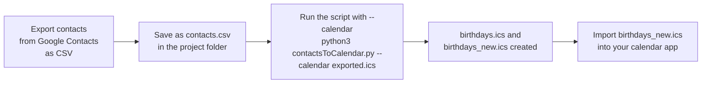

# Contact2BirthdayCalendar

Small utility scripts for HZA.

## contactsToCalendar.py

Converts a contacts export into a calendar file of yearly recurring birthday events.

It reads a semicolon-delimited CSV with `First Name`, `Last Name` and `Birthday` columns, and writes an iCalendar (`.ics`) file that most calendar apps (Google Calendar, Apple Calendar, Outlook) can import.

### Motivation

Google no longer syncs contact birthdays to the calendar. As part of an agreement with a German regulator, Google is changing how it processes personal data. As a result, this feature may be less complete or not available. This script lets you export your contacts' birthdays yourself and import them into your calendar.

### Workflow



1. **Export** your contacts from Google Contacts as a CSV file.
2. **Save** the file as `contacts.csv` in the project folder.
3. **Run** `python3 contactsToCalendar.py --calendar exported.ics`, where `exported.ics` is an export of your calendar. This writes `birthdays.ics` and `birthdays_new.ics`.
4. **Import** `birthdays_new.ics` into your calendar app (for example, Google Calendar: *Settings → Import & export → Import*). It holds only the birthdays that are not already in your calendar.

### Birthday formats

| Format | Example | Result |
|---|---|---|
| `--MM-DD` (no year) | `--03-31` | Yearly event on that date, title without a year |
| `DD/MM/YYYY` | `15/03/1990` | Yearly event on that date, title includes the birth year, e.g. `(1990)` |
| `YYYY-MM-DD` (ISO) | `1990-03-15` | Same as above |

- `--02-29` (Feb 29) is placed on the next leap year, so the event repeats only in leap years.
- Rows with no birthday are skipped.
- Rows with an unparseable date are skipped, and a message is printed naming the contact.

### Usage

Requires Python 3 (standard library only, no packages to install).

1. Put your contacts export in the project folder as `contacts.csv`.
2. Choose what to generate:

   ```bash
   # Birthday calendar (writes birthdays.ics); running with no options does the same
   python3 contactsToCalendar.py --ics

   # Cleaned CSV with only First Name, Middle Name, Last Name and Birthday (writes contacts_clean.csv)
   python3 contactsToCalendar.py --csv

   # Both, with custom file names
   python3 contactsToCalendar.py -i my_contacts.csv --csv cleaned.csv --ics out.ics

   # Compare with an exported calendar (writes birthdays.ics and birthdays_new.ics)
   python3 contactsToCalendar.py --calendar exported.ics
   ```

3. Import the `.ics` file into your calendar app. If you used `--calendar`, import `birthdays_new.ics`.

With `--calendar`, `birthdays_new.ics` holds only the birthdays that are not already in the exported calendar (matched by name, year and month and day). Importing it avoids duplicate birthday events. `birthdays.ics` still holds every birthday.

Run `python3 contactsToCalendar.py --help` for all options:

| Option | Meaning |
|---|---|
| `-i`, `--input FILE` | Contacts CSV to read (default `contacts.csv`) |
| `--csv [FILE]` | Write a cleaned CSV, dropping empty rows (default `contacts_clean.csv`) |
| `--ics [FILE]` | Write a birthday calendar (default `birthdays.ics`). This is also the output when neither `--csv` nor `--ics` is given. |
| `--calendar FILE` | Exported calendar (`.ics`) to compare against. Also writes `birthdays_new.ics`, the birthdays not already in that calendar. |

### Tests

The tests use only the Python standard library. Run them from the project folder:

```bash
# Run the tests and write an HTML report (tests/reports/test-report.html)
python3 tests/run_tests.py

# Or just run them with unittest's plain output
python3 -m unittest discover -s tests -v
```

`run_tests.py` exits with `0` when everything passes and `1` otherwise. Use `-o FILE` to choose another report file, and `-q` to hide the per-test output.

The tests live in `tests/`:

| Path | Purpose |
|---|---|
| `tests/test_contacts_to_calendar.py` | All test cases |
| `tests/run_tests.py` | Runs the tests and writes the HTML report |
| `tests/reports/` | Generated reports (not committed) |
| `tests/fixtures/example.csv` | Sample Google Contacts export used as test input |
| `tests/expected/clean_example.csv` | Expected output of `--csv` for the sample file |


### Files

| File | Purpose |
|---|---|
| `contactsToCalendar.py` | The script |
| `contacts.csv` | Input contacts export (personal data; see below) |
| `birthdays.ics` | Generated calendar output (personal data; see below) |
| `references/example_birthdays.ics` | Example of an exported calendar event, for reference |

### Privacy

`contacts.csv` and `birthdays.ics` contain personal information about real people. Keep them out of public repositories and shared locations, or add them to `.gitignore`.

### Editor setup

`.vscode/launch.json` contains a debug configuration that runs the currently open Python file from the project folder.
